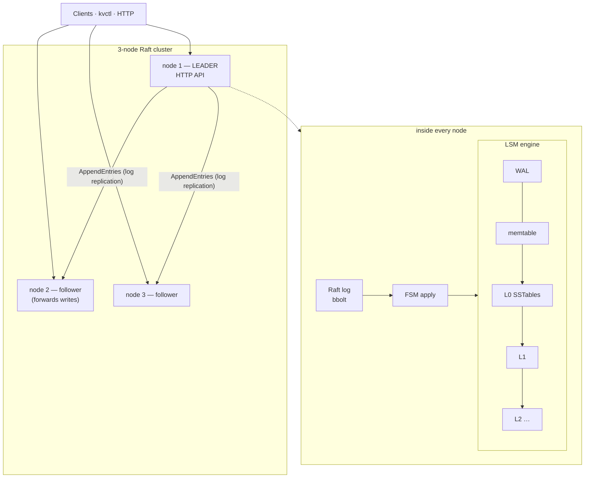

# Key-Value Store

A production-grade, distributed key-value store written in Go, built from two layers you can
study independently:

1. **`engine/`** — an embedded **LSM-tree storage engine written from scratch** (the design
   behind LevelDB, RocksDB, Cassandra and ScyllaDB): write-ahead log, skiplist memtable, SSTables
   with bloom filters and checksums, an LRU block cache, leveled compaction, snapshots and crash
   recovery.
2. **`internal/cluster/`** — **Raft replication** (via `hashicorp/raft`) that turns N engines into
   one fault-tolerant, strongly consistent database with leader election, automatic failover,
   linearizable reads, compare-and-swap and snapshot-based catch-up.



## Features

| Layer | Features |
| --- | --- |
| Engine | WAL with CRC32C + torn-write detection · lock-free-read skiplist memtable · immutable SSTables (4 KiB blocks, sparse index, bloom filter, footer) · LRU block cache · leveled compaction with trivial moves and tombstone GC · write stalls (backpressure) · atomic batches · point-in-time snapshots · range scans · ref-counted versions · atomic manifest · directory lock |
| Cluster | Raft consensus · automatic leader election & failover · 3 read consistency levels (strong/ReadIndex, leader, stale) · linearizable compare-and-swap · atomic multi-key batches · dynamic membership (join/remove) · follower → leader request forwarding · exactly-once apply across restarts (applied index stored with the data) · snapshot install for lagging nodes |
| Ops | HTTP API · `kvctl` CLI with built-in load test · `kvbench` engine benchmark · Prometheus metrics (Raft + engine internals) · health/readiness · docker-compose 3-node cluster · CI |

## Quick start

```bash
make build
make local-cluster            # 3 nodes on 127.0.0.1:8081-8083

./bin/kvctl -addr http://127.0.0.1:8082 put users/42 '{"name":"Ada"}'   # sent to a follower → forwarded
./bin/kvctl -addr http://127.0.0.1:8083 get users/42                      # linearizable read
./bin/kvctl cas lock - owner-1                                            # create-if-absent
./bin/kvctl scan -prefix users/
./bin/kvctl status                                                        # who is leader?
./bin/kvctl bench -n 20000                                                # load test

pkill -f "kvstore -id n1"     # kill the leader: another node takes over in ~1-2 s
```

Or with Docker: `make cluster-up` (nodes on :8081–:8083, Prometheus on :9090).

Engine only (embedded, no network):

```go
db, _ := engine.Open("./data", engine.Options{Sync: true})
defer db.Close()
db.Put([]byte("k"), []byte("v"))
v, _ := db.Get([]byte("k"))
kvs, _ := db.Scan([]byte("a"), []byte("m"), 100)
```

`./bin/kvbench -n 500000` on a laptop: ~400k sequential writes/s, ~200k random reads/s,
~2M reads/s for missing keys (bloom filters), write amplification ≈ 4.

## Project layout

```
engine/               LSM storage engine (no dependencies)
  wal.go              write-ahead log
  skiplist.go         memtable
  sstable.go          SSTable writer/reader + iterator
  bloom.go, cache.go  bloom filter, LRU block cache
  iterator.go         merging + level iterators
  version.go          versions, table ref-counting, manifest
  compaction.go       leveled compaction
  db.go               DB: open/recover, write & read paths, flush, snapshots, metrics
internal/cluster/     Raft integration: FSM, snapshots, consistency levels, membership
internal/server/      HTTP API, forwarding, Prometheus collector
cmd/kvstore/          server binary
cmd/kvctl/            CLI + HTTP load generator
cmd/kvbench/          engine benchmark (db_bench style)
deploy/               docker-compose + Prometheus
docs/                 learning guide
```

## Documentation

The [`docs/`](docs/README.md) folder is a learning guide:

1. [Fundamentals](docs/01-fundamentals.md) — storage engines, B-tree vs LSM, amplification
2. [The storage engine](docs/02-storage-engine.md) — write path, SSTables, bloom filters, read path
3. [Compaction](docs/03-compaction.md) — leveled compaction, tombstones, write amplification, versions
4. [Durability & recovery](docs/04-durability-and-recovery.md) — fsync, WAL replay, crash scenarios
5. [Replication with Raft](docs/05-replication-raft.md) — elections, log replication, FSM, snapshots, consistency
6. [API & CLI reference](docs/06-api.md)
7. [Operations](docs/07-operations.md) — deployment, metrics, tuning, runbook
8. [Exercises](docs/08-exercises.md)

## Development

```bash
make test-race   # engine model-based tests, crash/corruption tests, 3-node Raft tests, HTTP tests
make bench
make lint
```
