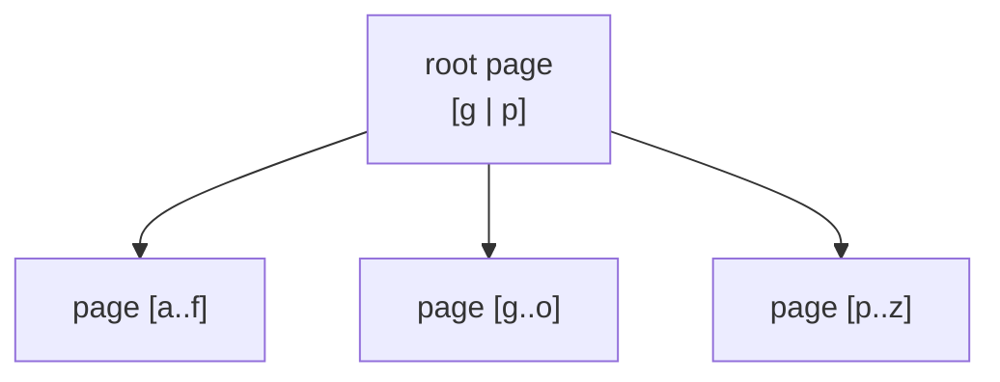
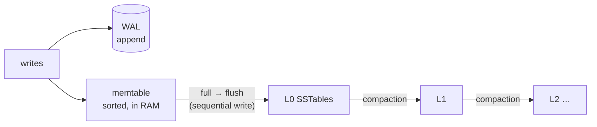

# 1. Fundamentals

## 1.1 What is a key-value store?

The simplest database interface there is:

```
Put(key, value)     Get(key) → value     Delete(key)     Scan(start, end) → [(key, value)…]
```

Keys and values are byte strings. Keys are **ordered**, which enables range scans
(`users/0001` … `users/9999`) and prefix queries — the building block for tables, indexes and
queues in systems like CockroachDB, TiKV, etcd and FoundationDB, which are all key-value stores at
their core.

Two questions define any KV store:

1. **How is data stored on one machine?** — the *storage engine* (chapters 2–4).
2. **How is it kept on several machines so that losing one loses nothing?** — *replication*
   (chapter 5).

## 1.2 The storage problem

Disks (SSDs included) are fast at **sequential** I/O and much slower at **random** small writes;
every write that must survive a crash needs an expensive `fsync`. A storage engine's job is to turn
a stream of random `Put`s into disk I/O that is efficient, while keeping `Get` fast.

There are two dominant designs.

### B-trees (update in place)



Pages (4–16 KiB) are updated **in place**. A write finds the leaf page and rewrites it (plus a WAL
record). Reads are one root-to-leaf walk. Used by PostgreSQL, MySQL/InnoDB, SQLite, BoltDB.

- ✅ Fast, predictable reads.
- ❌ Every small write rewrites a whole page — random I/O and high write amplification.

### LSM trees (log-structured, merge later)



Writes go to an append-only log and a sorted in-memory table. When memory fills, it is written out
**sequentially** as an immutable sorted file. Background **compaction** merges files to discard
old versions. Used by LevelDB, RocksDB, Cassandra, ScyllaDB, HBase, and this project.

- ✅ Very high write throughput (only sequential I/O), good compression, SSD-friendly.
- ❌ Reads may need to check several files (mitigated by bloom filters and compaction); background
  compaction costs I/O.

## 1.3 The three amplifications

Every storage engine trades off three costs (the "RUM conjecture": Read, Update, Memory — you can
optimise two at the expense of the third):

| Amplification | Definition | LSM behaviour |
| --- | --- | --- |
| **Write** | bytes written to disk ÷ bytes the user wrote | Each byte is rewritten once per level it passes through (≈ 4–10×+) |
| **Read** | disk reads ÷ one logical read | Possibly one probe per level; bloom filters make most probes free |
| **Space** | bytes on disk ÷ live data | Overwritten/deleted data lingers until compacted (≈ 1.1× with leveled compaction) |

`kvbench` prints the engine's measured write amplification and bloom filter effectiveness so you
can see these trade-offs directly:

```
write amplification=4.14  block cache hit rate=54.3%  bloom filter skips=572259 (false positives 4702)
```

## 1.4 Why an LSM tree here?

- It is the dominant design for write-heavy and distributed databases.
- Every component — log, skiplist, sorted files, bloom filters, k-way merge, compaction — is a
  classic data structure worth knowing.
- Immutable files make snapshots, backups and replication-friendly designs natural: a snapshot is
  just "these files + this memtable".

## 1.5 Replication preview

A single machine can die. Replicating to N machines raises the question: *which copy is right?*
Raft answers it by electing a **leader** that orders all writes into a **log**, replicating the log
to followers, and declaring an entry **committed** once a **majority** has it. Every node applies
committed entries in the same order to its own storage engine, so all engines end up identical.
With 3 nodes the cluster survives 1 failure; with 5, 2.

Next: [2. The storage engine →](02-storage-engine.md)
