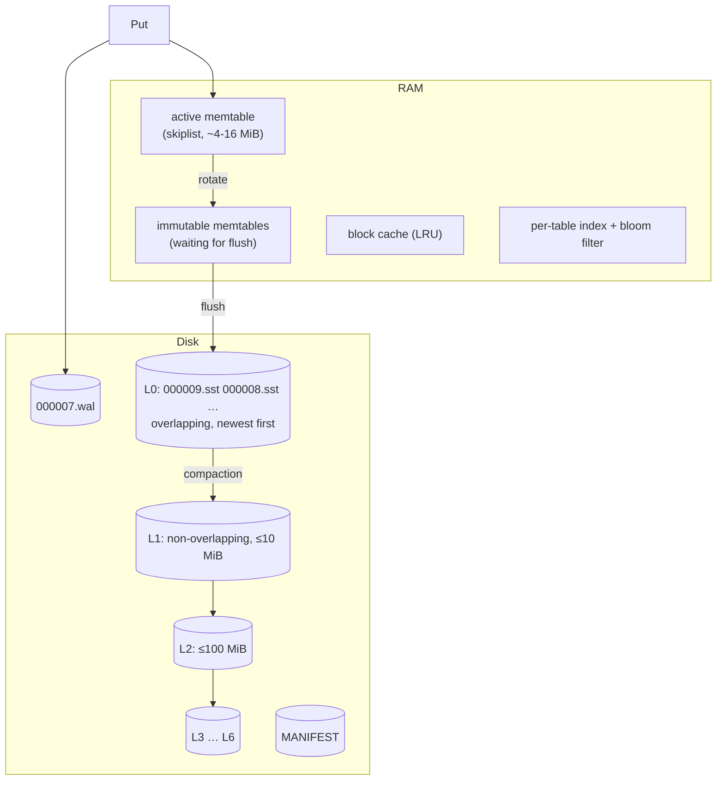
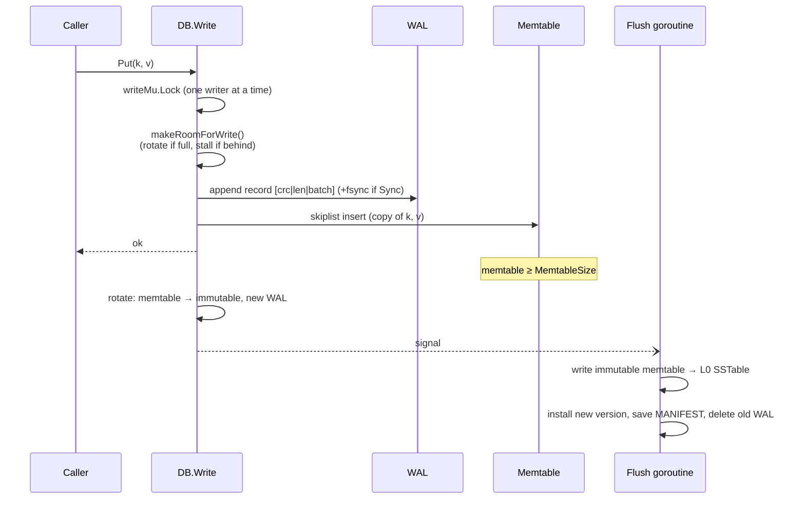
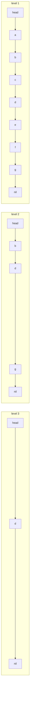
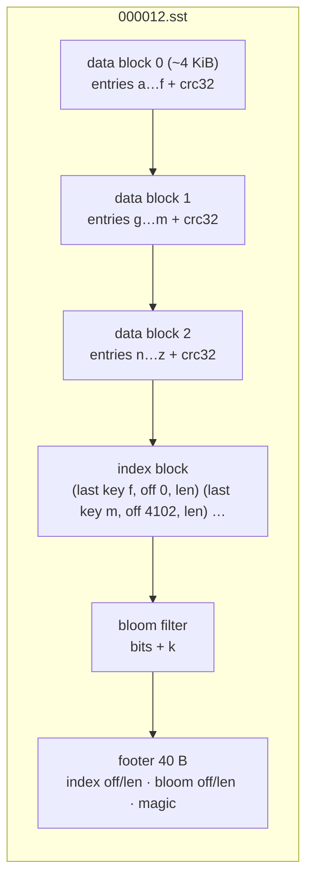
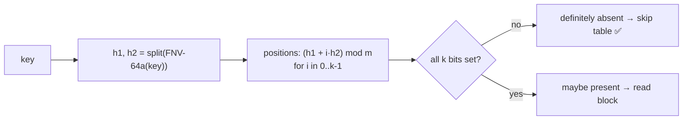
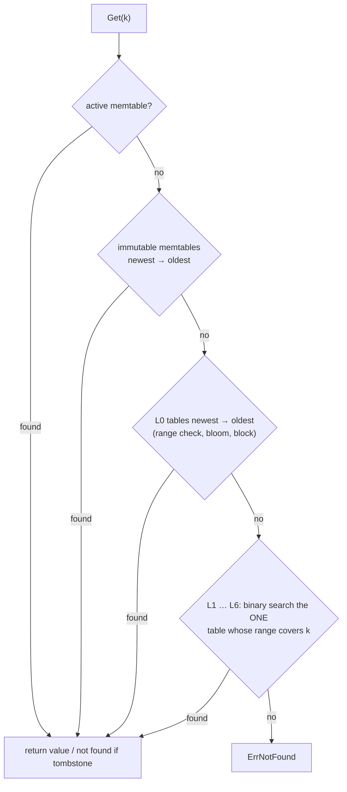
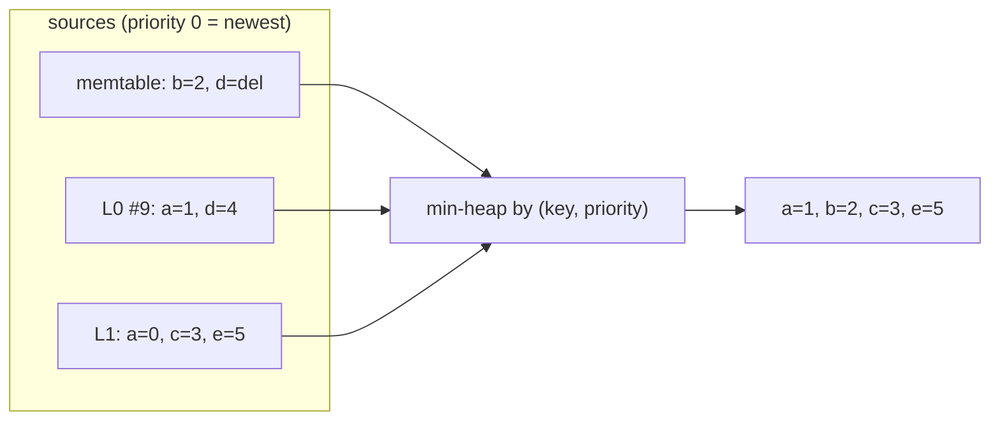

# 2. The Storage Engine

This chapter follows a key from `Put` to disk and back. Code: [`engine/`](../engine).

## 2.1 Big picture



## 2.2 Write path



1. **WAL first.** The batch is encoded and appended to the write-ahead log *before* touching memory.
   If the process dies right after `Put` returns, the WAL has the data. ([`wal.go`](../engine/wal.go))
2. **Memtable.** The operations are inserted into a skiplist. Deletes insert a **tombstone**.
3. **Rotation.** When the memtable exceeds `MemtableSize`, it becomes *immutable* and a new
   memtable + WAL take over. Writes continue immediately; a background goroutine flushes.
4. **Backpressure.** If flushing (too many immutable memtables) or compaction (too many L0 files)
   falls behind, writers **stall** until it catches up — the alternative is unbounded memory and
   unbounded read cost. (`makeRoomForWrite` in [`db.go`](../engine/db.go))

### Atomic batches

`db.Write(&batch)` encodes all operations into **one** WAL record protected by one checksum. On
recovery a record is either fully valid (all ops replayed) or rejected (none), so batches are
atomic across crashes.

```
WAL record:  crc32c(4) | length(4) | count(uvarint) | op… 
op:          kind(1: value|tombstone) | klen(uvarint) | key | vlen(uvarint) | value
```

## 2.3 The memtable: a skiplist

A skiplist is a sorted linked list with "express lanes": each node is promoted to the next level
with probability ¼, giving O(log n) search without the rebalancing of a balanced tree.



Search for `f`: start top-left, move right while the next key is smaller, else drop a level.

**Concurrency** ([`skiplist.go`](../engine/skiplist.go)): writers are serialised by the DB, but
readers take **no lock**. A new node is fully built, then linked in with atomic pointer stores from
the bottom level up; a reader either sees the complete node or not at all. Overwrites atomically
swap the node's `entry` pointer. This is the same trick LevelDB uses.

## 2.4 SSTable format

When a memtable is flushed (or compaction produces output), keys are written in sorted order into
an immutable **SSTable** ([`sstable.go`](../engine/sstable.go)):



- **Entry**: `kind | klen | vlen | key | value` (varint lengths).
- **Data blocks** are the unit of I/O and caching; each ends with a CRC32C so corruption is
  detected on read (`TestCorruptBlockDetected`).
- The **index** stores each block's *last* key: binary search finds the only block that can hold a
  key.
- The **footer** is fixed size, at the very end, so a reader can find everything else from it.
- Opening a table loads index + bloom filter into memory; after that, a lookup costs **at most one
  block read**.

## 2.5 Bloom filters

Before reading a block, the table's bloom filter is asked "might this key be here?"
([`bloom.go`](../engine/bloom.go)):



With 10 bits per key and k = 7 hash functions the false-positive rate is ≈ 1 %
(`TestBloomFilterFalsePositiveRate`). That is why `readmissing` in `kvbench` runs ~10× faster than
`readrandom`: lookups for absent keys almost never touch the disk.

*Double hashing* (Kirsch–Mitzenmacher) derives all k positions from one 64-bit hash, which is
provably as good as k independent hash functions for this purpose.

## 2.6 Block cache

Recently read blocks are kept, already checksum-verified, in an LRU cache keyed by
`(table number, block offset)` ([`cache.go`](../engine/cache.go)). Hot keys are served from memory;
the OS page cache provides a second layer beneath it.

## 2.7 Read path



The **first** place that knows about the key wins, because sources are searched from newest to
oldest. A tombstone found early correctly hides an older value further down.

## 2.8 Iterators and range scans

A scan must merge many sorted sources — the memtables, every L0 table and one "level iterator" per
deeper level — into one sorted stream. [`iterator.go`](../engine/iterator.go) implements a
**k-way merge** with a min-heap:



When several sources hold the same key, only the newest is emitted and the others are advanced
past it; tombstones are then filtered out for user-facing scans (but kept by compaction, see next
chapter). A **level iterator** walks the non-overlapping tables of one level in order, opening each
lazily.

## 2.9 Versions and snapshots

The set of live SSTables is an immutable **version**. Readers *pin* the current version (ref
count), so compaction can install a new version and mark old files obsolete without deleting a file
someone is still reading; the file is removed when its last reference goes away
([`version.go`](../engine/version.go)).

`db.Snapshot()` rotates the memtable (so every memtable it references is immutable) and pins the
version: the result is a consistent, point-in-time view (`TestSnapshotIsolation`). The Raft layer
uses it to stream snapshots while writes continue.

Next: [3. Compaction →](03-compaction.md)
