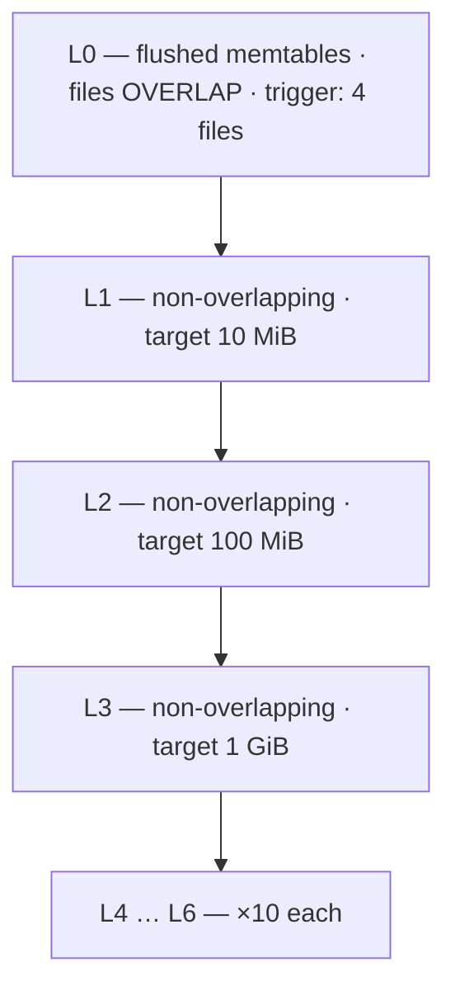
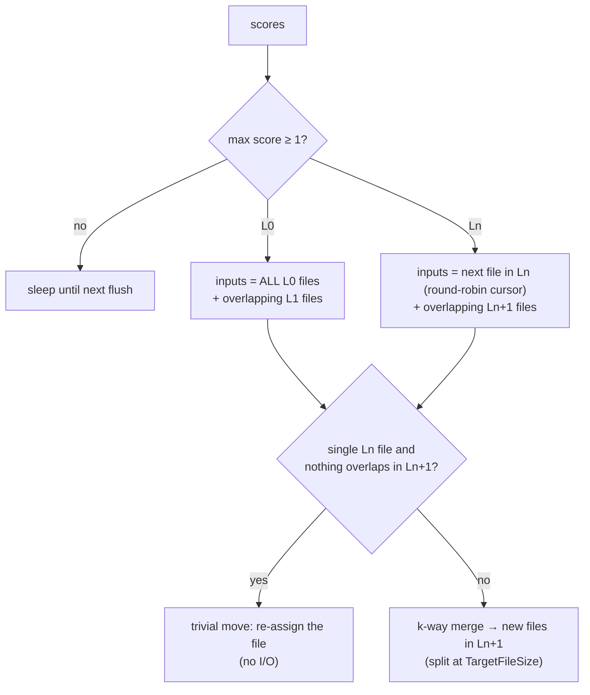
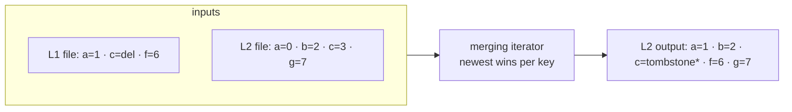
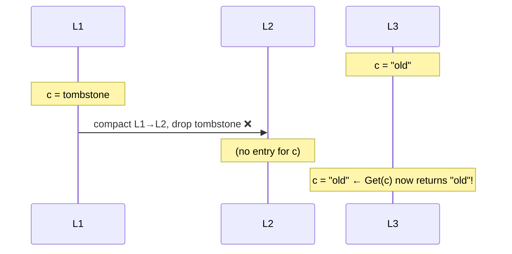
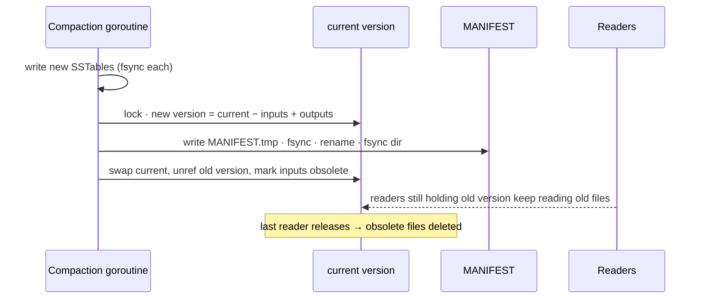

# 3. Compaction

Without compaction an LSM tree would accumulate L0 files forever: reads would check hundreds of
files and every overwritten or deleted value would occupy disk forever. Compaction merges files to
bound **read amplification** and **space amplification**, paying for it with **write
amplification**. Code: [`engine/compaction.go`](../engine/compaction.go).

## 3.1 Leveled layout



- **L0** files come straight from memtables, so their key ranges overlap: a read may check all of
  them. Their count is therefore kept small.
- **L1+** are each one sorted run split into ~2 MiB files with **disjoint** key ranges: a read checks
  at most **one file per level**.
- Each level is ~10× bigger than the previous one, so ~90 % of data lives in the last level and
  space amplification stays ≈ 1.1×.

## 3.2 Picking what to compact

A background goroutine computes a **score** per level and compacts the highest score ≥ 1:

```
score(L0) = number of L0 files / L0CompactionTrigger (4)
score(Ln) = bytes in Ln / (BaseLevelSize × 10^(n-1))
```



The **round-robin cursor** (`compPtr`) makes successive compactions of a level walk through the
whole key space instead of hammering one range.

A **trivial move** is a pure metadata change: e.g. sequential inserts produce L1 files that never
overlap L2, so they can be pushed down without rewriting a byte (`kvbench fillseq` shows many).

## 3.3 Merging



\* the tombstone is kept or dropped according to §3.4.

The same merging iterator used for scans produces the output; for each key only the newest version
survives, which is how overwritten data is reclaimed.

## 3.4 Tombstones: when can a delete be forgotten?

A tombstone must be kept as long as an **older** value for that key might exist in a **deeper**
level — dropping it early would *resurrect* the deleted value:



So the engine drops tombstones only when **no level below the output overlaps the compaction's
key range** (`dropTombstones` in `runCompaction`). In the example above the tombstone travels down
with the data until it meets and cancels the old value.

## 3.5 Installing the result atomically



The new version is derived from the **current** version at install time, not the one the
compaction started from, because flushes may have added L0 files in the meantime.

If the process crashes before the manifest rename, the new files are orphans and are deleted on
the next `Open`; the old files are still referenced, so nothing is lost.

## 3.6 Write stalls

Compaction is the engine's garbage collector; if writes outpace it, reads degrade and memory grows.
The engine applies backpressure:

| Condition | Effect |
| --- | --- |
| `MaxImmutableMemtables` (2) waiting for flush | writers wait |
| `L0StopWritesTrigger` (12) L0 files | writers wait |

`write_stalls` in `/v1/stats` counts these events. Frequent stalls mean the disk cannot sustain the
write rate: raise `MemtableSize`, add I/O capacity, or reduce write volume.

## 3.7 Write amplification, measured

Each byte is written: once to the WAL, once when flushed, and roughly once per level it moves
through (more when a level's file overlaps several files below). The engine reports

```
write_amplification = (user bytes + flush bytes + compaction bytes written) / user bytes
```

For the `kvbench` default run this is ≈ 4. Production LSMs typically see 10–30× — a key trade-off
you can explore in [Exercise 3](08-exercises.md).

## 3.8 Leveled vs tiered compaction

| | Leveled (this engine, LevelDB/RocksDB default) | Size-tiered (Cassandra STCS) |
| --- | --- | --- |
| Shape | one sorted run per level | several similarly-sized runs per tier |
| Read amp | low (1 file per level) | higher |
| Space amp | low (~1.1×) | high (up to 2× during compaction) |
| Write amp | higher | lower |

Next: [4. Durability & recovery →](04-durability-and-recovery.md)
