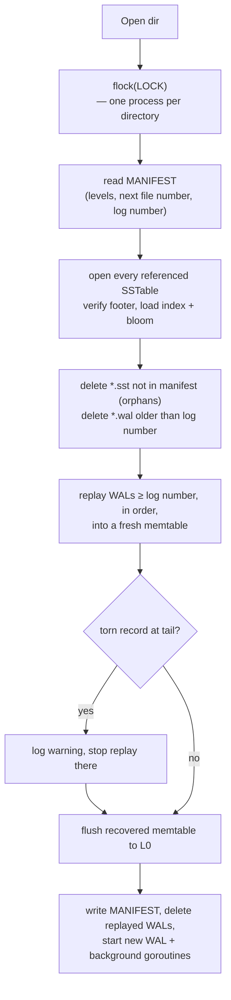

# 4. Durability & Recovery

A database is only as good as what it still has after the power cord is pulled. This chapter
lists exactly what the engine promises and how each promise is implemented.

## 4.1 Layers of "written"

| Data is in… | Survives process crash | Survives OS crash / power loss |
| --- | --- | --- |
| Go buffer | ❌ | ❌ |
| OS page cache | ✅ | ❌ |
| fsynced | ✅ | ✅ |

The WAL writer flushes its buffer to the OS on **every** write, so an acknowledged write always
survives a *process* crash. With `Options.Sync = true` it also `fsync`s, so it survives power loss
at the cost of one fsync per write (≈ 0.1–10 ms depending on the device). The Raft layer runs the
engine with `Sync = true`, and amortises it by applying many log entries per batch.

## 4.2 Every file write is crash-safe

| File | Technique |
| --- | --- |
| WAL | Append-only; every record has length + CRC32C; a torn final record is detected and ignored |
| SSTable | Written to a new file, fsynced, and only then referenced by the manifest |
| MANIFEST | Written to `MANIFEST.tmp`, fsynced, atomically `rename`d, then the directory is fsynced |
| Obsolete files | Deleted only after the manifest no longer references them |

`rename` is atomic on POSIX filesystems: after a crash you see either the old or the new manifest,
never a mix. Fsyncing the directory makes the rename itself durable.

## 4.3 Recovery (`Open`)

The **log number** in the manifest is the oldest WAL whose data is not yet in an SSTable. It
advances every time a flush is installed, which is what makes old WALs safe to delete.

## 4.4 Crash scenarios

| Crash moment | On restart | Test |
| --- | --- | --- |
| After `Put` returned | Replayed from WAL | `TestRecoveryFromWALWithoutClose` |
| Mid-WAL-append | Torn record ignored; that write was never acknowledged | `TestTornWALTailIsIgnored` |
| Mid-flush (SST half written) | SST not in manifest → deleted; data replayed from WAL (still present, since log number did not advance) | orphan cleanup in `recover` |
| After flush wrote SST, before manifest | Same as above | |
| Mid-compaction | Outputs are orphans → deleted; inputs still referenced → nothing lost | |
| After manifest rename, before deleting old files | Old files are orphans → deleted | |
| Bit rot in an SST block | Read fails with a checksum error instead of returning bad data | `TestCorruptBlockDetected` |

## 4.5 Errors that stop the world

If a background flush or compaction fails (disk full, I/O error), the engine records a
**background error**: all subsequent writes return it (read-only mode) rather than continuing on
top of an uncertain state. Reads keep working. Restarting the process re-runs recovery.

## 4.6 Durability in the cluster

In the replicated store, a write is acknowledged only after:

1. a **majority** of nodes has appended it to their Raft log (bbolt, fsynced), and
2. the leader has **applied** it to its engine (fsynced WAL batch).

So an acknowledged write survives the loss of any minority of nodes, *and* a simultaneous power
failure of all of them. How the Raft log and the engine stay in sync across restarts is covered in
[chapter 5](05-replication-raft.md#56-exactly-once-apply-across-restarts).

Next: [5. Replication with Raft →](05-replication-raft.md)
