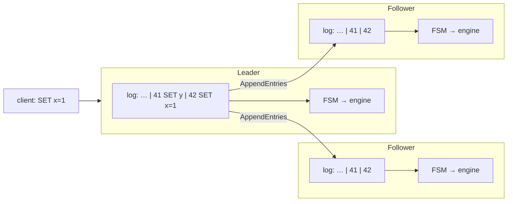
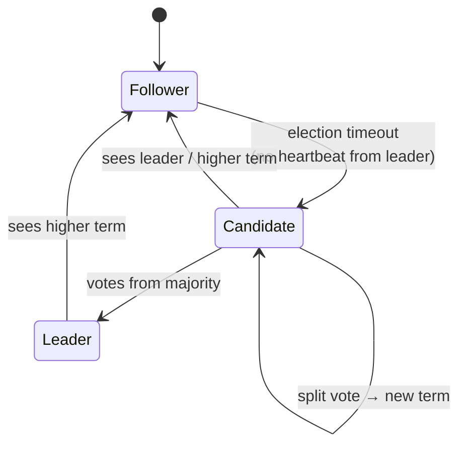
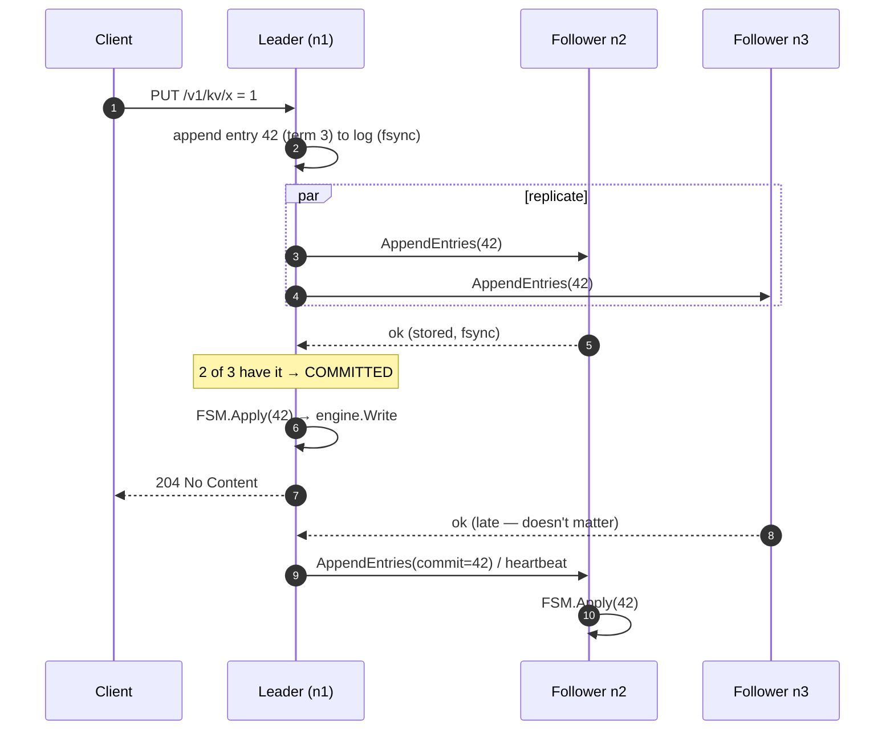
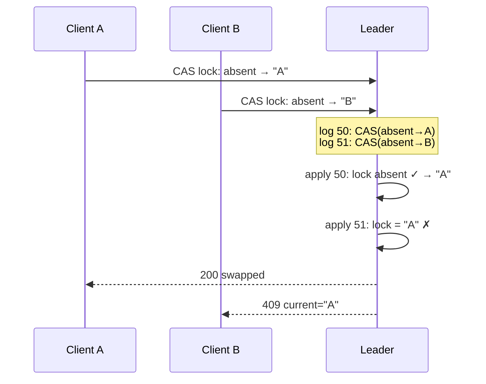
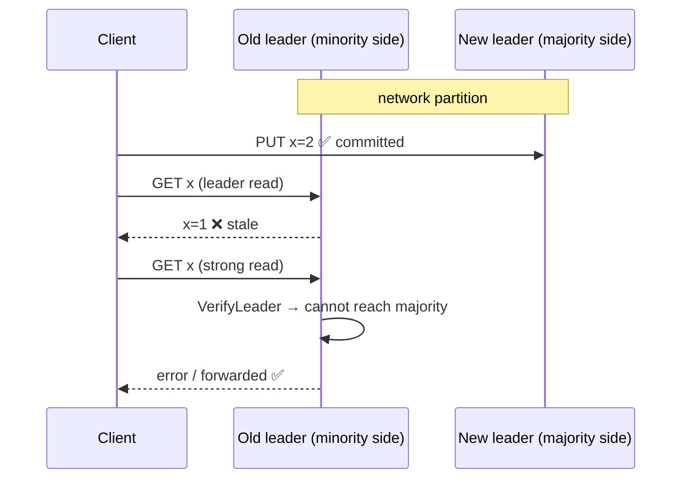
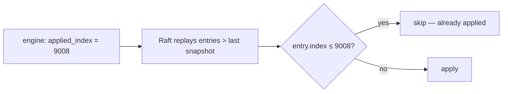
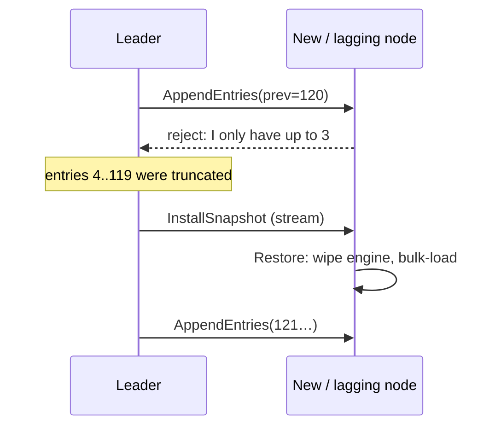
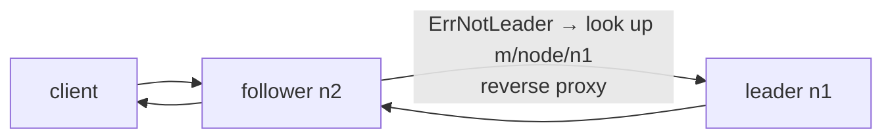

# 5. Replication with Raft

One engine on one machine is a single point of failure. This chapter explains how
[`internal/cluster`](../internal/cluster) turns several engines into one fault-tolerant database.

## 5.1 The replicated state machine idea

> If every replica starts in the same state and applies **the same operations in the same order**,
> every replica ends in the same state.

So the problem reduces to agreeing on **one ordered log of operations**. That is what a consensus
algorithm provides; Raft is the most widely used one (etcd, Consul, CockroachDB, TiKV, …).



## 5.2 Raft in five minutes

**Roles.** Each node is a *follower*, *candidate* or *leader*. Time is divided into numbered
**terms**; each term has at most one leader.



**Leader election.** A follower that hears nothing from a leader for a randomised election timeout
becomes a candidate, increments the term and asks for votes. A node votes at most once per term,
and only for a candidate whose log is at least as up to date as its own — which guarantees the new
leader has every committed entry. Randomised timeouts make split votes rare.

**Log replication.** The leader appends each command to its log and sends `AppendEntries` to
followers (also used as heartbeats). An entry is **committed** once stored on a **majority**. The
leader then applies it to its state machine and replies to the client; followers learn the commit
index from later messages and apply too.



**Safety.** A committed entry is never lost or reordered: any future leader must have received
votes from a majority, and every majority overlaps the majority that stored the entry.

| Cluster size | Majority | Failures tolerated |
| --- | --- | --- |
| 1 | 1 | 0 |
| 3 | 2 | 1 |
| 5 | 3 | 2 |

Even sizes add no tolerance (4 nodes tolerate 1, like 3) — use odd numbers.

This project uses **hashicorp/raft** for the protocol (elections, replication, log storage in
bbolt, snapshot transfer) and implements the parts specific to a database: the FSM, snapshots,
consistency levels, CAS, membership and request routing.

## 5.3 Commands and the FSM

Every mutation is a JSON `Command` in a log entry ([`fsm.go`](../internal/cluster/fsm.go)):

```json
{"op":"set","key":"eA==","value":"MQ=="}
{"op":"cas","key":"…","expected":"…","value":"…"}
{"op":"batch","ops":[{"op":"set",…},{"op":"delete",…}]}
{"op":"meta","key":"node/n2","value":"http://10.0.0.2:8080"}
```

Keys are namespaced inside the engine: user data under `u/`, cluster metadata under `m/`
(node HTTP addresses, the applied index).

The FSM implements `raft.BatchingFSM`: Raft hands it up to 64 committed entries at a time, which
it writes as **one engine batch with one fsync**, making durable replication fast.

## 5.4 Compare-and-swap is linearizable for free

CAS checks the current value **when the entry is applied**, in log order, on every replica:



Both requests raced, but the log imposed an order, and every replica reaches the same verdict.
This is the primitive for distributed locks, leader leases and optimistic concurrency.

## 5.5 Reads and consistency levels

Writes always go through the log. Reads can choose ([`store.go`](../internal/cluster/store.go)):

| Level | How | Guarantee | Cost |
| --- | --- | --- | --- |
| `strong` (default) | **ReadIndex**: leader notes `commitIndex`, confirms leadership with a heartbeat round to a majority, waits until it has applied up to that index, then reads locally | Linearizable | 1 network round trip, no disk write |
| `leader` | Leader reads locally | Usually fresh; a deposed leader that has not noticed may be stale briefly | Local |
| `stale` | Any node reads locally | May lag the leader | Local, scales with replicas |

Why is `leader` not enough for linearizability? During a network partition an old leader may still
believe it leads while a new leader (in the majority partition) accepts writes:



## 5.6 Exactly-once apply across restarts

Raft may re-deliver entries after a restart. The FSM stores `m/applied_index` **in the same engine
batch** as the entries' effects, so the engine and the index can never disagree. On restart:



Because the engine is durable, the node is configured with `NoSnapshotRestoreOnStart`: it does
**not** rebuild its state from a snapshot at every boot, so restarts are fast regardless of data
size (`TestRestartDoesNotReapply`).

## 5.7 Snapshots and log compaction

The Raft log cannot grow forever. Every `SnapshotThreshold` entries (8192) Raft asks the FSM for a
snapshot and then truncates the log.

- `FSM.Snapshot()` calls `engine.Snapshot()` — a cheap point-in-time view (memtable rotation +
  pinned version). Raft guarantees no `Apply` runs concurrently with this call.
- `Persist()` streams every key/value as length-prefixed frames while new writes continue.
- A follower that is so far behind that the leader no longer has the entries it needs receives the
  snapshot (`InstallSnapshot`) and `FSM.Restore()` rebuilds its engine from the stream
  (`TestNewNodeCatchesUpFromSnapshot`).



## 5.8 Membership and routing

- **Bootstrap**: the first node starts with `-bootstrap` and forms a one-node cluster.
- **Join**: a new node calls `POST /cluster/join` on any member; the leader calls `AddVoter`, and
  records the node's HTTP address in replicated metadata (`m/node/<id>`) so every node can find
  every other node's API.
- **Remove**: `DELETE /cluster/nodes/{id}`.
- **Routing**: any node accepts any request. A follower that receives a write or a `strong`/`leader`
  read proxies it to the leader's HTTP address (with a loop guard header).



## 5.9 Failure scenarios

| Failure | Behaviour |
| --- | --- |
| Follower dies | Cluster continues (majority intact); follower catches up from the log (or a snapshot) when it returns |
| Leader dies | Followers time out (~1 s), elect a new leader; in-flight writes that were not committed fail and should be retried by the client |
| Network partition | Majority side elects/keeps a leader and serves writes; minority side cannot commit or serve strong reads |
| Majority lost | No writes, no strong reads (safety over availability — CP in CAP terms); `stale` reads still work |
| Disk failure on a node | Replace the node: remove it, wipe, re-join; it receives a snapshot |

Next: [6. API & CLI →](06-api.md)
