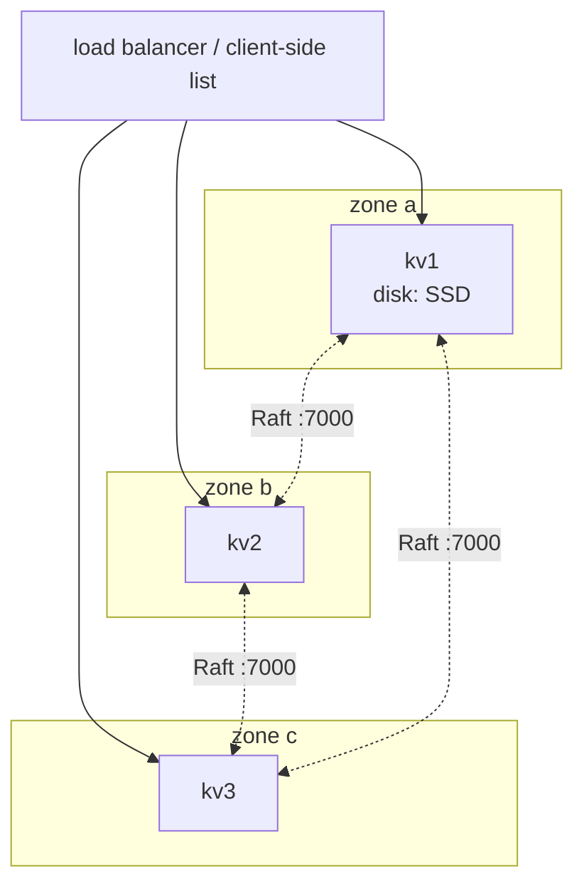

# 7. Operations

## 7.1 Deployment



- Run **3 or 5** nodes, each in a different failure domain (zone/rack).
- Node ids and Raft addresses must be **stable** (StatefulSet + headless service in Kubernetes).
- Use local SSDs; the workload is fsync-heavy.
- Put the HTTP port behind a load balancer or give clients all node addresses — any node accepts
  any request.

Starting a cluster:

```bash
kvstore -id kv1 -data /data -http 0.0.0.0:8080 -http-advertise http://kv1:8080 \
        -raft 0.0.0.0:7000 -raft-advertise kv1:7000 -bootstrap
kvstore -id kv2 … -join http://kv1:8080
kvstore -id kv3 … -join http://kv1:8080
```

`-bootstrap` only acts on an empty data directory, so it is safe to leave on kv1's restart
command.

## 7.2 Metrics

| Metric | Meaning / alert idea |
| --- | --- |
| `kv_raft_is_leader` | Exactly one node should report 1: `sum(kv_raft_is_leader) != 1` for 30 s |
| `kv_raft_term` | Increases on every election; frequent increases = unstable leadership |
| `kv_raft_commit_index − kv_raft_applied_index` | Apply lag |
| `kv_raft_nodes` | Membership size |
| `kv_engine_level_files{level="0"}` | Near `L0StopWritesTrigger` (12) → write stalls imminent |
| `kv_engine_level_bytes` | Data distribution per level |
| `kv_engine_events_total{event="write_stall"}` | Increasing → disk can't keep up |
| `kv_engine_events_total{event="bloom_negative"}` | Disk reads avoided |
| `kv_engine_events_total{event="cache_hit"|"cache_miss"}` | Block cache hit ratio |
| `kv_engine_write_amplification` | Disk write cost per user byte |
| `kv_http_request_duration_seconds{route}` | Client-facing latency |

## 7.3 Tuning

| Knob | Bigger means | Trade-off |
| --- | --- | --- |
| `-memtable-mb` | Fewer, larger L0 files; fewer flushes | More RAM; longer WAL replay after a crash |
| `-cache-mb` | Higher cache hit ratio | RAM |
| `BloomBitsPerKey` | Fewer false positives | ~1.25 bytes RAM per key per 10 bits |
| `BaseLevelSize` / `LevelMultiplier` | Fewer levels | Larger, longer compactions |
| `SnapshotThreshold` | Fewer snapshots | Longer Raft log, slower catch-up |

Run `go run ./cmd/kvbench` with different `engine.Options` to see the effect before changing
production.

## 7.4 Backups

Options, from simplest:

1. **Raft snapshot files** in `<data>/snapshots/` — force one with `POST /cluster/snapshot`, copy
   the newest directory. Restoring = start a fresh node and let it install the snapshot, or
   replay the frames with a small tool.
2. **Logical export** — `GET /v1/scan` with pagination.
3. **Filesystem snapshot** of a follower's data directory (consistent because every file is
   either immutable or append-only with checksums).

## 7.5 Runbook

| Symptom | Check | Action |
| --- | --- | --- |
| `503 no leader` | `kvctl status` on each node; logs for elections | Restore a majority; check network between Raft ports |
| Frequent elections (term climbing) | Disk latency (fsync), CPU starvation, network | Faster disks; dedicate CPUs; raise Raft timeouts |
| Write latency high | `write_stall` events, L0 files, disk util | Larger memtable, faster disk, lower write rate |
| A node won't rejoin | Its Raft address changed? | `kvctl remove <id>`, wipe its data dir, start with `-join` |
| Node lost its disk | — | Remove, replace, re-join: it receives a snapshot |
| `engine entered read-only mode` in logs | Disk full / I/O errors | Free space / replace disk; restart node |
| Stale reads observed | Client using `consistency=stale` | Use `strong` (default) where freshness matters |

Next: [8. Exercises →](08-exercises.md)
