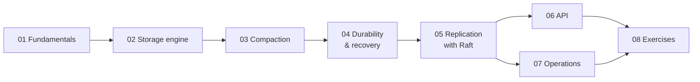

# Learning Guide — Distributed Key-Value Store

This guide takes you from "how is data laid out on disk?" to "how do three machines agree on it?",
using this repository's code as the running example.

| # | Chapter | You will learn |
| - | --- | --- |
| 1 | [Fundamentals](01-fundamentals.md) | What a storage engine does, B-trees vs LSM trees, read/write/space amplification |
| 2 | [Storage engine](02-storage-engine.md) | WAL, skiplist memtable, SSTable format, bloom filters, block cache, read path, merging iterators |
| 3 | [Compaction](03-compaction.md) | Why and how tables are merged, leveled compaction, tombstone GC, write stalls, versions |
| 4 | [Durability & recovery](04-durability-and-recovery.md) | fsync, torn writes, atomic manifest updates, what survives which crash |
| 5 | [Replication with Raft](05-replication-raft.md) | Leader election, log replication, commit, the FSM, snapshots, consistency levels, CAS |
| 6 | [API & CLI](06-api.md) | HTTP endpoints, `kvctl`, the Go engine API |
| 7 | [Operations](07-operations.md) | Deployment, flags, metrics, tuning, backups, runbook |
| 8 | [Exercises](08-exercises.md) | Hands-on labs |

**Suggested path:** chapters 1–4 with `engine/` open, running `go run ./cmd/kvbench` to watch the
LSM shape evolve; then chapter 5 while running `make local-cluster` and killing nodes.

## Glossary

| Term | Meaning |
| --- | --- |
| **LSM tree** | Log-Structured Merge tree: buffer writes in memory, write sorted immutable files, merge them in the background |
| **WAL** | Write-ahead log: append-only file making in-memory writes durable |
| **Memtable** | In-memory sorted buffer of recent writes |
| **SSTable** | Sorted String Table: immutable on-disk file of sorted key/value pairs |
| **Level (L0…L6)** | Groups of SSTables; each deeper level ~10× larger |
| **Compaction** | Merging SSTables to discard overwritten/deleted data and keep reads fast |
| **Tombstone** | A deletion marker; needed because older values may exist in older files |
| **Bloom filter** | Compact probabilistic set answering "definitely not here" |
| **Amplification** | Extra work: bytes written/read/stored per logical byte |
| **Raft** | A consensus algorithm: a leader replicates a log to followers; an entry is committed once a majority stores it |
| **FSM** | Finite state machine: here, the storage engine, fed by committed Raft entries |
| **Linearizable** | Every operation appears to take effect at one instant between its start and end |
| **Quorum** | A majority of nodes (2 of 3, 3 of 5) |
